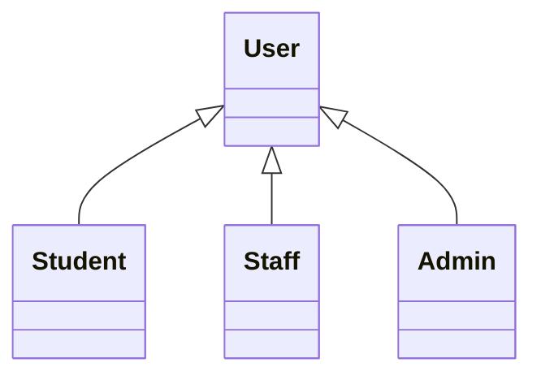

# 📚 Documentation Technique

## Description

Ce dossier contient toute la **documentation technique** du projet TchopMate, incluant les diagrammes UML, la structure de la base de données, et l'analyse du système.

## 📁 Structure

```
documentation/
├── ClassDiagram.puml           # Diagramme de classes PlantUML
├── class_diagram.md            # Documentation du diagramme de classes
├── UseCaseDiagram.puml         # Diagramme des cas d'utilisation
├── objectDiagram.puml          # Diagramme d'objets
├── gestion_bd.md               # Documentation base de données
├── script_bd.md                # Scripts SQL et structure DB
├── Dod spring 1                # Definition of Done Sprint 1
└── SequenceDiagram/            # Diagrammes de séquence
    ├── CommandeSequenceDiagram.puml
    ├── ConnexionSequenceDiagram.puml
    ├── CreerGerantSequenceDiagram.puml
    ├── RestaurantSequenceDiagram.puml
    └── SignUpSequenceDiagram.puml
```

## 📊 Diagrammes UML

### Diagramme de Classes

**Fichier:** `ClassDiagram.puml` + `class_diagram.md`

Représente la structure des classes principales:
- Compte (User)
- Restaurant
- Menu
- Plat
- Commande
- LigneCommande

### Diagramme de Cas d'Utilisation

**Fichier:** `UseCaseDiagram.puml`

Décrit les interactions entre les acteurs et le système:
- **Étudiant:** Passer commande, consulter menu, voir historique
- **Gérant:** Gérer restaurant, gérer menus, traiter commandes
- **Administrateur:** Gérer gérants, voir statistiques

### Diagrammes de Séquence

**Dossier:** `SequenceDiagram/`

Détaillent les flux d'exécution pour:
- **Commande:** Processus de création d'une commande
- **Connexion:** Authentification utilisateur
- **CreerGerant:** Création d'un compte gérant par l'admin
- **Restaurant:** Opérations sur les restaurants
- **SignUp:** Inscription d'un nouvel utilisateur

### Diagramme d'Objets

**Fichier:** `objectDiagram.puml`

Montre des instances concrètes des classes à un moment donné.

## 🗄️ Documentation Base de Données

### `gestion_bd.md`

Documentation complète de la base de données:
- Structure des tables
- Relations entre tables
- Contraintes et index
- RLS (Row Level Security) policies
- Triggers et fonctions

**Tables principales:**
- `compte` - Utilisateurs
- `restaurant` - Restaurants
- `menu` - Menus
- `plat` - Plats
- `commande` - Commandes
- `ligne_commande` - Détails des commandes

### `script_bd.md`

Scripts SQL pour:
- Création des tables
- Insertion de données de test
- Migrations
- Requêtes courantes

## 🎯 Méthodologie Agile

### `Dod spring 1`

Definition of Done pour le Sprint 1:
- Critères d'acceptation
- Tests requis
- Documentation nécessaire
- Review checklist

## 📝 Tâches à Venir

### Diagrammes Manquants

- [ ] **Diagramme de Déploiement**
  - Architecture cloud (Supabase, Vercel)
  - Services externes (Google OAuth)
  - CDN et assets

- [ ] **Diagramme d'Architecture Clean**
  - Layers: Core, Data, Hooks, UI
  - Flow de dépendances
  - Injection de dépendances

- [ ] **Diagramme d'États**
  - États d'une commande (pending → preparing → ready → delivered)
  - États d'un restaurant (open/closed)

- [ ] **Diagramme d'Activités**
  - Processus de paiement
  - Workflow de validation commande

### Documentation à Créer

- [ ] **API Documentation**
  - Endpoints disponibles
  - Request/Response formats
  - Codes d'erreur
  - Exemples d'utilisation

- [ ] **Database Schema Diagram**
  - Schéma visuel avec toutes les relations
  - Contraintes de clés étrangères
  - Index et performances

- [ ] **Security Documentation**
  - Politiques RLS détaillées
  - Gestion des rôles et permissions
  - OAuth flow complet
  - Bonnes pratiques sécurité

- [ ] **Deployment Guide**
  - Configuration environnements
  - Variables d'environnement
  - CI/CD pipeline
  - Rollback procedures

### Mises à Jour Nécessaires

- [ ] Mettre à jour les diagrammes avec Clean Architecture
- [ ] Ajouter les nouvelles entités (Payment, Notification)
- [ ] Documenter les Use Cases
- [ ] Créer un glossaire des termes métier

## 🛠️ Outils Utilisés

### PlantUML

Pour visualiser les diagrammes `.puml`:

**Option 1: VS Code**
- Installer l'extension "PlantUML"
- Ouvrir le fichier `.puml`
- `Alt+D` pour preview

**Option 2: En ligne**
- Aller sur http://www.plantuml.com/plantuml/uml/
- Coller le contenu

**Option 3: CLI**
```bash
npm install -g node-plantuml
plantuml ClassDiagram.puml
```

### Mermaid (Alternative)

Considérer l'utilisation de Mermaid pour les diagrammes dans Markdown:



## 📊 Schéma de Base de Données Simplifié

```
┌─────────────┐
│   compte    │
├─────────────┤
│ id          │
│ email       │
│ role        │
└──────┬──────┘
       │
       │ 1:n
       ↓
┌─────────────┐      ┌─────────────┐
│ restaurant  │──────│    menu     │
├─────────────┤ 1:n  ├─────────────┤
│ id          │      │ id          │
│ gerant_id   │      │ restaurant  │
└─────────────┘      └──────┬──────┘
                            │ 1:n
                            ↓
                     ┌─────────────┐
                     │    plat     │
                     ├─────────────┤
                     │ id          │
                     │ menu_id     │
                     └─────────────┘
```

## 🔍 Comment Naviguer

### Pour comprendre le système
1. Commencer par `UseCaseDiagram.puml` - Vue d'ensemble
2. Lire `class_diagram.md` - Structure des données
3. Explorer les diagrammes de séquence - Flows détaillés

### Pour la base de données
1. Lire `gestion_bd.md` - Documentation complète
2. Utiliser `script_bd.md` - Scripts SQL
3. Voir les diagrammes de classes pour les relations

### Pour le développement
1. Consulter les diagrammes de séquence pour le flow
2. Référencer `gestion_bd.md` pour les requêtes
3. Suivre le DoD pour les standards de qualité

## 📚 Documentation Projet Complète

À la racine du projet:
- `README.md` - Overview général
- `CLEAN_ARCHITECTURE.md` - Architecture détaillée
- `MIGRATION_GUIDE.md` - Guide de migration
- `TESTING_GUIDE.md` - Guide des tests
- `OAUTH_REFACTORING.md` - Refactoring OAuth

## 🎓 Ressources Externes

### UML
- [PlantUML Documentation](https://plantuml.com/)
- [UML Class Diagrams](https://www.uml-diagrams.org/class-diagrams-overview.html)

### Base de Données
- [PostgreSQL Documentation](https://www.postgresql.org/docs/)
- [Supabase Documentation](https://supabase.com/docs)

### Architecture
- [Clean Architecture (Uncle Bob)](https://blog.cleancoder.com/uncle-bob/2012/08/13/the-clean-architecture.html)
- [Hexagonal Architecture](https://alistair.cockburn.us/hexagonal-architecture/)

---

**Dernière mise à jour:** 11 novembre 2025  
**Statut:** Documentation de base - À compléter avec Clean Architecture
